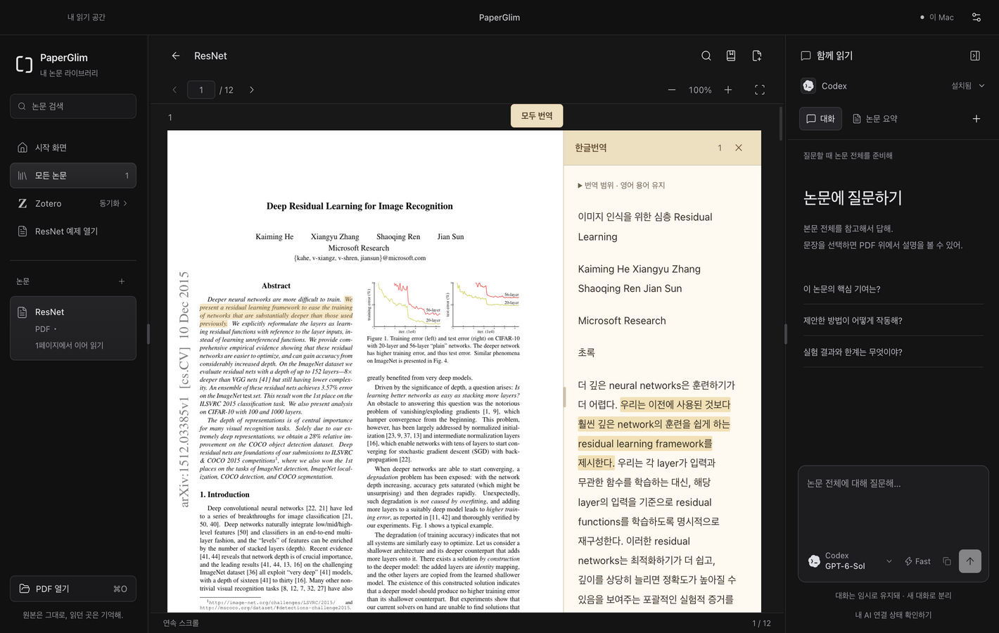

# Pagecove

원문 옆에서 한글 번역을 읽고, 평소 쓰는 Codex나 Claude Code에 질문할 수 있는 Mac용 논문 리더예요.

[Mac용 다운로드](https://iontail.github.io/pagecove/) · [릴리스 노트](https://github.com/iontail/Pagecove/releases) · [사용법](https://iontail.github.io/pagecove/#how-to)

## 주요 기능

- **원문 옆 번역.** 한 페이지나 논문 전체를 번역하고, 번역 문장에 마우스를 올려 해당 원문을 확인하세요.
- **논문 채팅과 요약.** 논문 전체를 바탕으로 질문하고, 세 문장 요약에 이어 방법·실험·한계를 살펴보세요.
- **문장·수식·그림 해설.** 읽다가 막힌 부분을 선택해 질문하고, 저장한 설명을 원문에서 다시 열 수 있어요.
- **Zotero 연결.** Mac에 내려받은 논문을 기존 컬렉션과 함께 가져올 수 있어요.

## 시작하기

1. macOS 13 이상의 Apple Silicon Mac에서 DMG를 열고, Pagecove를 ‘응용 프로그램’ 폴더로 옮기세요. 처음 실행이 차단되면 [설치 안내](https://iontail.github.io/pagecove/#first-open)를 확인하세요.
2. PDF를 창에 끌어다 놓거나 앱에 포함된 ResNet 예제를 여세요. Zotero를 쓰고 있다면 [연결 안내](https://iontail.github.io/pagecove/#zotero-setup)를 따라 PDF를 가져올 수 있어요.
3. 번역이나 질문을 쓰려면 Mac에 설치한 Codex 또는 Claude Code에 로그인하세요. Pagecove의 ‘설정 → AI 연결’에서 모델을 선택할 수 있어요.

설치한 뒤에는 ‘설정 → 데이터·앱 정보’에서 업데이트를 확인할 수 있어요.

## 데이터와 AI 사용

논문 목록, 읽던 위치, 저장한 설명과 번역은 이 Mac에 남아요. AI 기능을 쓰면 요청에 필요한 논문 텍스트, 질문, 선택한 그림·표가 연결한 AI 서비스로 전송돼요. 외부 전송이 제한된 문서는 PDF 읽기 기능을 이용하세요.

Pagecove는 무료예요. AI 사용 한도와 비용은 연결한 계정의 요금제에 따라 달라져요. 스캔 PDF의 문자 인식(OCR)은 아직 지원하지 않아요. AI 답변과 번역은 원문과 함께 확인해 주세요.

## 소스에서 실행

Node.js 24 이상에서 `npm ci`로 의존성을 설치한 뒤 `npm run dev`를 실행하세요. 테스트는 `npm test`로 실행할 수 있어요.

화면 예시는 He 외 저자의 [ResNet 논문](https://arxiv.org/abs/1512.03385)을 사용했어요. 문제가 생기면 [GitHub Issues](https://github.com/iontail/Pagecove/issues)에 알려 주세요.
